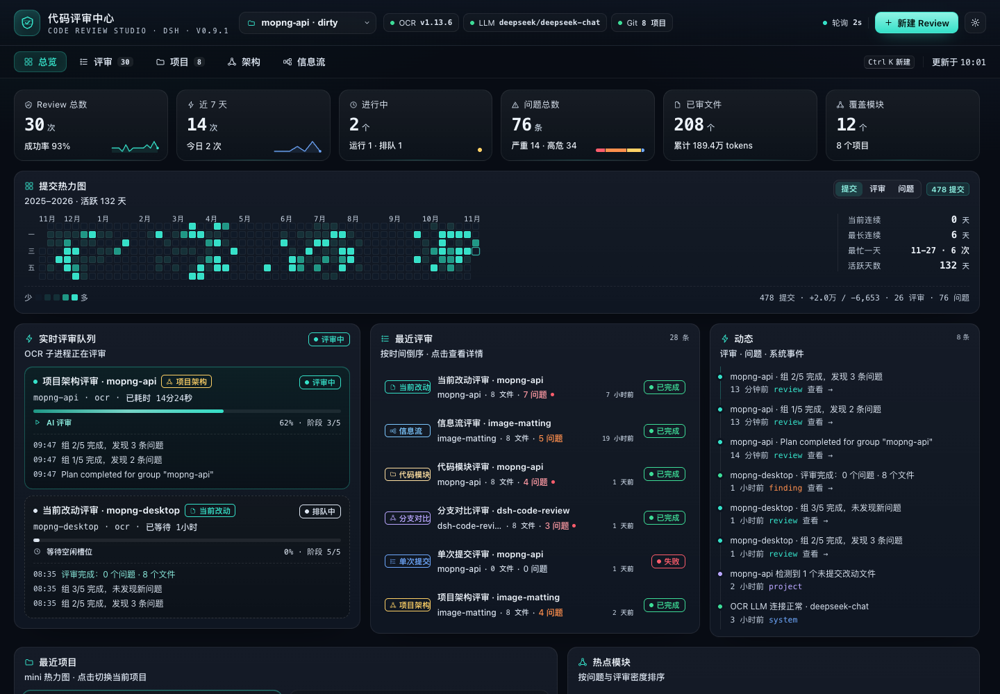
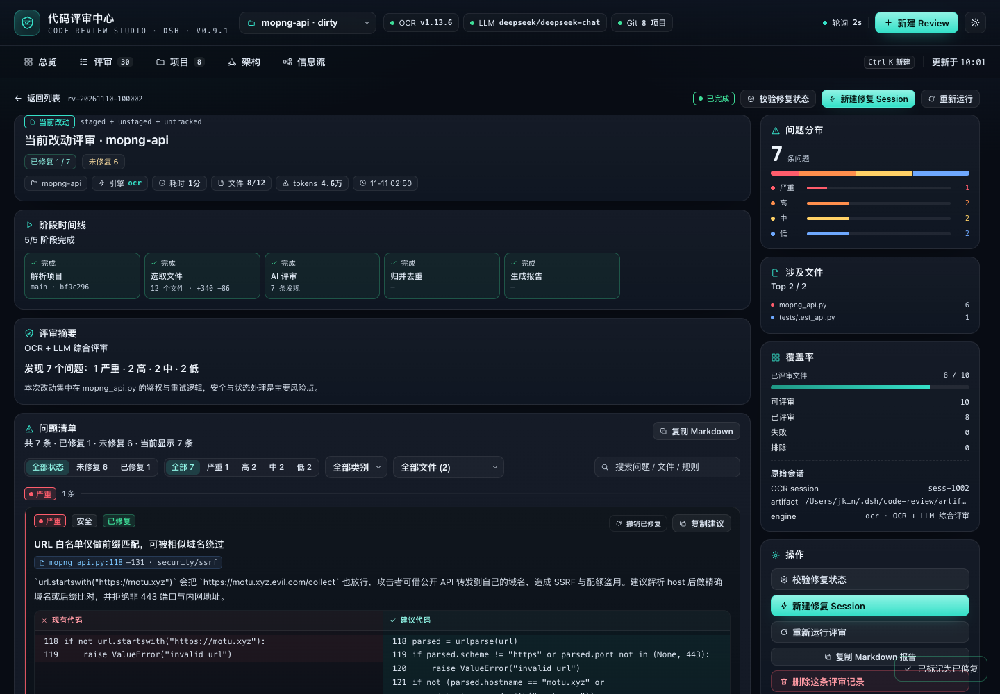
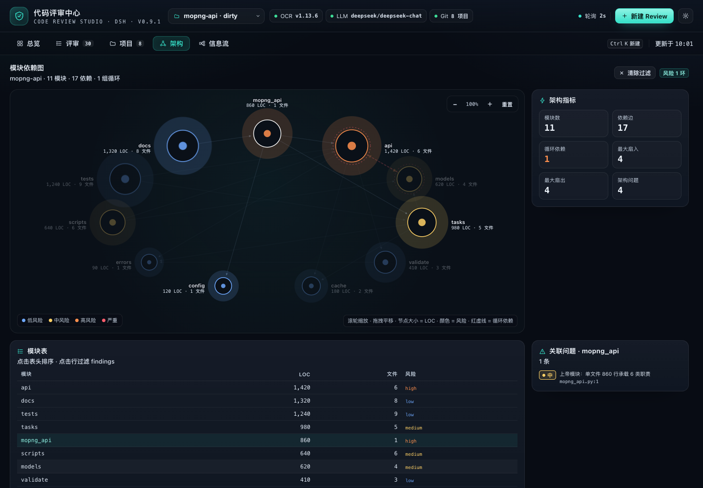

# dsh-code-review

English | [简体中文](README.zh.md)

> A DeepSeek Harness code review plugin built on [alibaba/open-code-review](https://github.com/alibaba/open-code-review).
> Four review types (current changes / project architecture / code modules / business data-flow workflows), live progress and activity,
> a GitHub-style commit heatmap, review details and per-project/module stats — all on one screen.



## Features

- **Four review types**
  - **Current changes**: staged + unstaged + untracked (`ocr review`)
  - **Single commit / branch comparison**: `ocr review --commit`, `--from/--to`
  - **Project architecture**: multi-language import dependency graph, Tarjan cycle detection, layering / god modules / missing tests (local analysis + `ocr scan`)
  - **Code module**: whole-file review of a specified directory or file (`ocr scan --path`)
  - **Business data-flow workflow**: entry → service → data/external dependencies, checking validation, authorization, transactions, idempotency, timeouts and swallowed exceptions
- **Automatic engine selection**
  1. `ocr`: the LLM bundled with OCR (`OCR_LLM_*` / `~/.opencodereview/config.json`)
  2. `delegate`: OCR selects files and resolves rules, while the review itself runs on the current DSH session model (no extra API key)
  3. `structural`: offline structural analysis with zero LLM dependency; falls back automatically when no model is available and says so
- **Live and traceable**: a six-stage state machine per review, stage progress, activity stream, cancel and retry, plus automatic "interrupted" marking after a Host restart
- **GitHub-style heatmap**: 53 weeks × 7 days, three metrics (commits / reviews / findings), hover for that day's commits, additions and deletions, reviews and findings, plus streaks and the busiest day
- **Details and stats**: findings grouped by severity, file:line, side-by-side original vs. suggested code, copy suggestion;
  recently reviewed projects, hotspot modules, severity/category distribution, coverage
- **Project page / architecture dependency graph / data-flow swimlane diagram / new-review dialog / settings drawer**






> The screenshots are rendered by the preview harness; the project list uses public repository names from [@jkin8010](https://github.com/jkin8010), and the review data is demo data.

## Installation

Requires DeepSeek Harness (with the Web UI), the `ocr` CLI ≥ 1.13, `git`, and Node 22+.

### One-click install (paste the prompt below into DSH)

```text
Please install the DSH plugin https://github.com/jkin8010/dsh-code-review: use plugin_manager's install_bundle to install this Git repository directly. When it finishes, check whether the plugin is enabled, run ocr --version, check the LLM engine status, and tell me whether DSH needs a restart.
```

> The repository root `package.json` is the DSH bundle declaration, so the plugin can be **installed straight from the Git URL** (the plugin code itself lives in `plugins/dsh-code-review/`).
> If `plugin_manager` returns `restart-required`, restart DSH to apply it; if it reports the change as applied, just refresh the page.

### Manual installation

```bash
# 1) Install the open-code-review CLI (optional; without it the plugin uses offline structural analysis)
npm i -g @alibaba-group/open-code-review

# 2) Install it in DSH (Plugins in the Web sidebar, or via the agent tool); these two targets are equivalent:
#    - Git URL:          https://github.com/jkin8010/dsh-code-review
#    - local clone root: /absolute/path/dsh-code-review
plugin_manager → action: install_bundle, target: https://github.com/jkin8010/dsh-code-review
```

> This plugin is a profile bundle; with HMR enabled it hot-loads, otherwise it takes effect after restarting DSH.
> The plugin itself has no third-party dependencies, so no extra `pnpm install` is needed.

### Configuring an LLM for OCR (optional)

By default `ocr` needs an LLM to do AI review; when none is configured the plugin automatically uses `delegate` (the current DSH model) or `structural` (offline analysis).

```bash
ocr config provider    # pick a provider and enter the API key
ocr config model
ocr llm test           # verify connectivity
```

Or supply one through the plugin config / environment variables (the token only exists in the Host process and is never sent back to the frontend):

```yaml
- id: qise-code-review
  name: '@jkin8010/dsh-code-review'
  config:
    projectRoots: [/Users/you/workspace]       # auto-discovers the immediate subdirectories that have a .git
    extraProjects: [/Users/you/current/repo]    # extra projects (may be non-Git)
    engine: auto                                # auto | ocr | structural
    ocr:
      llmUrl: ''
      llmTokenFile: ~/.config/ocr/token
      model: ''
      effort: medium                            # low | medium | high
      concurrency: 8
      timeoutMin: 15
```

See [plugins/dsh-code-review/README.md](plugins/dsh-code-review/README.md) for the full set of configuration options.

## Usage

### Review directly from a project conversation (recommended)

The plugin registers the model tool **`code_review`** (active after install/restart). In any project session you can simply say:

- "Review the architecture of the current project with the code review center"
- "Review the current changes, only high and above"
- "Review the `plugins/dsh-code-review/host` module"
- "Review this project's message pipeline from a data-flow perspective"
- "Show me the details of the most recent review"

Copy the line below to kick off a full review in one go:

```text
Review the current project with the code review center: start with the project architecture, then review the plugins/dsh-code-review/host module, and finally review the message pipeline from a data-flow perspective; anything below high can be skipped.
```

The Agent calls `code_review` → `start` (waiting for the review to finish by default) → and returns the issue summary and findings in the conversation; the full grouping, code suggestions and coverage remain available in the "Code Review Center" in the sidebar.

Tool arguments (the Agent fills them in automatically, but you can also ask for them directly):

| Argument | Description |
|---|---|
| `action` | `start` / `status` / `detail` / `list` |
| `project_path` | Omitted = the current session working directory (the current project) |
| `type` | `workspace` / `commit` / `range` / `architecture` / `module` / `flow`; when omitted, supplying `paths` means a module review, otherwise a project architecture review |
| `scope` | `paths` (module) / `commit` / `from`+`to` |
| `options` | `effort`, `background`, `exclude`, `max_tokens_budget` |
| `wait` | Defaults to `true` and waits for completion; `false` returns a job id immediately |
| `job_id` / `severity` / `limit` | Used when querying details |

> If you would rather not wait, say "run it in the background and tell me when it's done"; the Agent will use `wait:false` and fetch the result later with `status`/`detail`.

### Slash command `/code-review`

Besides having the Agent call the tool, you can also use slash commands right in the input box (mirroring the ocr CLI review types):

```text
/code-review workflow @test/                 # add test/ as a project and run the data-flow review
/code-review workflow --fix @test/           # same as above, then open a fix session automatically
/code-review architecture @/Users/me/proj    # project architecture
/code-review module src/server,src/db --fix  # code module + fix session
/code-review changes --effort high           # current changes
/code-review commit abc123
/code-review range main feature/login
/code-review fix                             # open a fix session for the most recent review
/code-review list / status [jobId]
```

- `@path` or `--project path`: **works even when the project is not in the list yet** — the command adds it as a project first, then runs the review;
  relative paths resolve against the current session directory
- `--fix`: opens a fix session in the project directory and sends it the findings once the review finishes
- `--async`: returns immediately after starting; `--effort` / `--background` / `--exclude` / `--budget` map to the review options
- With no subcommand, or with `help`, it prints the full usage

### Using it in the page

1. Open "Code Review Center" in the left sidebar and pick a project at the top (`projectRoots` auto-discovery + `extraProjects`).
2. Click "New Review" and choose a type:
   - Current changes / single commit / branch comparison: fill in the commit or from/to
   - Project architecture / code module / data flow: for a module review fill in the directory path; the data-flow review can be left empty for auto-discovery
3. After submitting, watch the stage progress and activity in the overview's "Live review queue", then click through to the details for the findings.
4. The overview heatmap and "recent projects / hotspot modules" track the review rhythm; the project page lets you switch the current project.
5. **One-click fix**: on the review details page click "New fix session" — the plugin creates a session in that project's Workspace
   and fills this review's findings (severity first, file name:line number, suggested code) into the composer as a **fix prompt draft**;
   press Enter to send (edit first if needed). `/code-review --fix` sends it automatically through the Host.
5. **The project list automatically includes**: Git repositories under `projectRoots` (default `/Users/jkin/workspace`, 2 levels deep),
   DSH workspaces, and projects that have already been reviewed (even if they are not under `projectRoots`).
6. **Fixed markers**: the review details page can mark/unmark "fixed" and filter by fix status; old findings that a new review no longer reports are marked fixed automatically.
7. **Automatic fix verification**: once a fix session was started from a report, opening the report again re-runs the same review type/scope automatically; findings that no longer appear are marked fixed (a manual "Verify fixes" button is also available).
7. **Any project**: the last entry of the project dropdown ("＋ Add project path…"), the "Add project" action on the project page, and **the project dropdown in New Review** can all add one;
   both the **built-in folder browser** and **manually typing an absolute path** are supported (the browser lists directories directly and can go up a level, with no system dialog),
   and additions are persisted in `<stateDir>/projects.json`.

## Repository structure

```
package.json                    # DSH bundle root manifest: dsh.bundle → plugins/dsh-code-review/cordis.patch.yml
plugins/dsh-code-review/        # plugin implementation (Host/Client/install package)
  index.js                     # Host: /api/code-review RPC, lifecycle, dependency wiring
  client.js                    # full-page Web UI (React.createElement, no build step)
  host/                        # git / ocr / analyzers / job state machine / snapshot / persistence / delegated review
  locale/                      # sidebar and settings copy
  cordis.patch.yml             # bundle default config
  screenshots/                 # UI screenshots
tests/code-review/             # self-tests (real git/ocr + fake Cordis/LLM) and the screenshot harness
docs/CODE-REVIEW-CONTRACT.md    # field/API contract between the plugin and the front/back end
docs/CODE-REVIEW-DELIVERY.md    # delivery and acceptance records, plus known limitations
docs/RELEASE-HISTORY.md        # archived notes for releases whose tags were cleaned up
```

## Verification

```bash
node tests/code-review/engine-selftest.mjs     # four review types + snapshots + persistence
node tests/code-review/delegate-selftest.mjs   # OCR file selection + DSH model review
node tests/code-review/host-selftest.mjs       # real git/ocr/analyze + the full RPC chain
node tests/code-review/git-ocr.test.mjs        # real repository + real ocr --preview (33 cases)
node tests/code-review/analyze.test.mjs        # architecture/module/data-flow/diff (8 cases)
node tests/code-review/preview/shoot.mjs       # real client.js rendering + screenshots + DOM assertions
```

## Design notes

- The Host owns all I/O: `git` / `ocr` subprocesses / persistence; the frontend only polls a single authenticated RPC snapshot (every 2s),
  and the Host caches projects, the heatmap and OCR health so polling never re-hits the upstream.
- Six-stage review state machine: `resolve → plan → structure → ai → merge → report`;
  if the AI stage fails or is unconfigured, it degrades to offline structural analysis and never fabricates conclusions.
- Review history is written atomically to `~/.dsh/code-review/` (index + details + daily stats + activity) and restored automatically on restart.
- Cancellation: `SIGTERM → 2s → SIGKILL`; retrying creates a new job; failure classes are actionable.

## Known limitations

- Offline analysis is heuristic (not AST), so call chains in dynamic languages are only linked one level deep; the data-flow graph is capped at 40 nodes.
- Current-change/commit/branch reviews need a Git repository; non-Git directories can still get architecture/module/data-flow reviews.
- The heatmap window is `today-(days-1)` in local time, so crossing a timezone boundary can be off by one day.
- `language` only recognizes the built-in extension table; full inspect is capped at 4000 files, and LOC skips binaries and files larger than 2MB.

## License

[Apache-2.0](LICENSE). The `ocr` engine comes from [alibaba/open-code-review](https://github.com/alibaba/open-code-review) (Apache-2.0).
