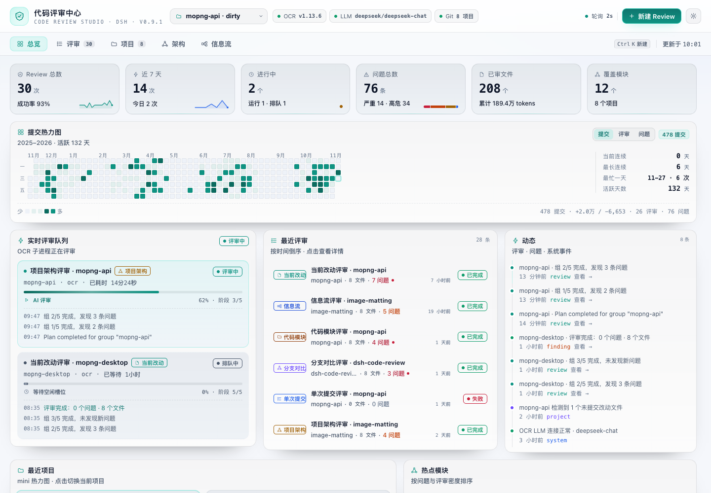
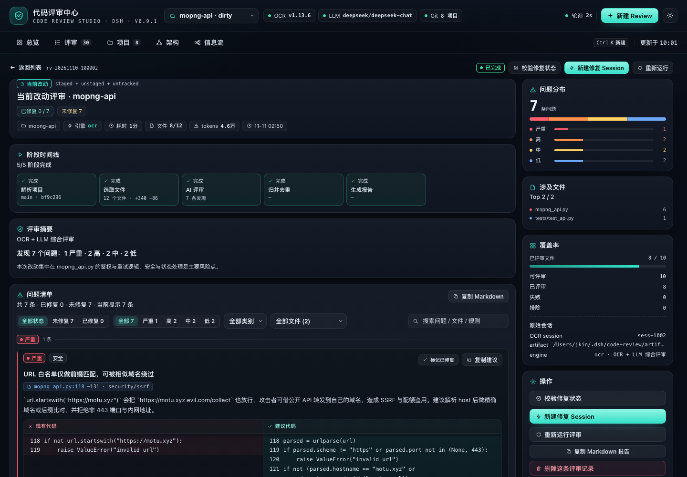
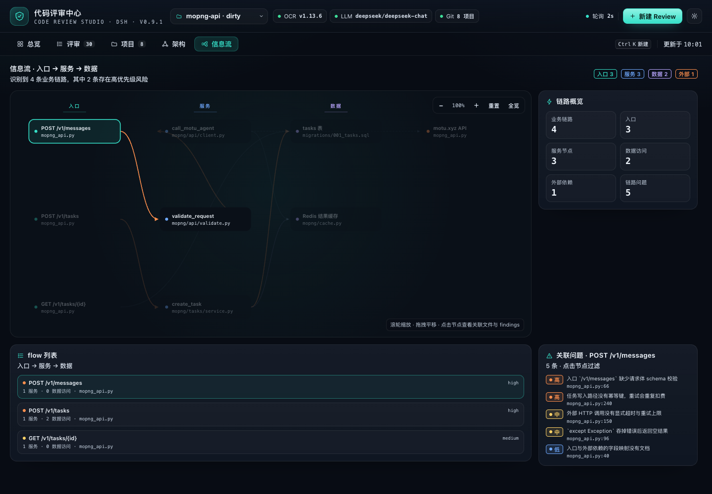
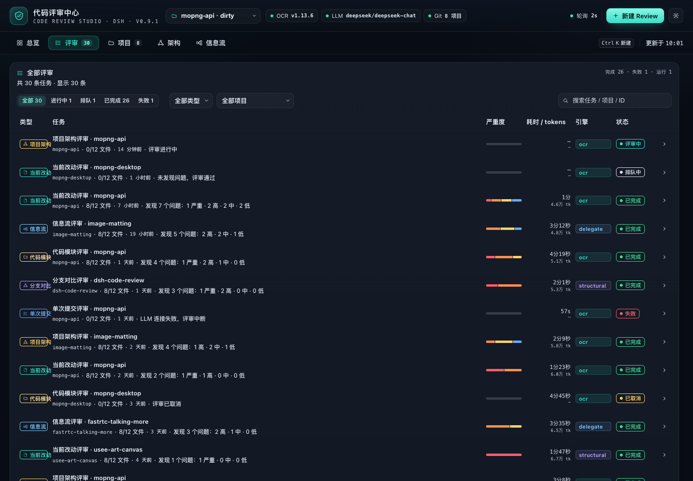
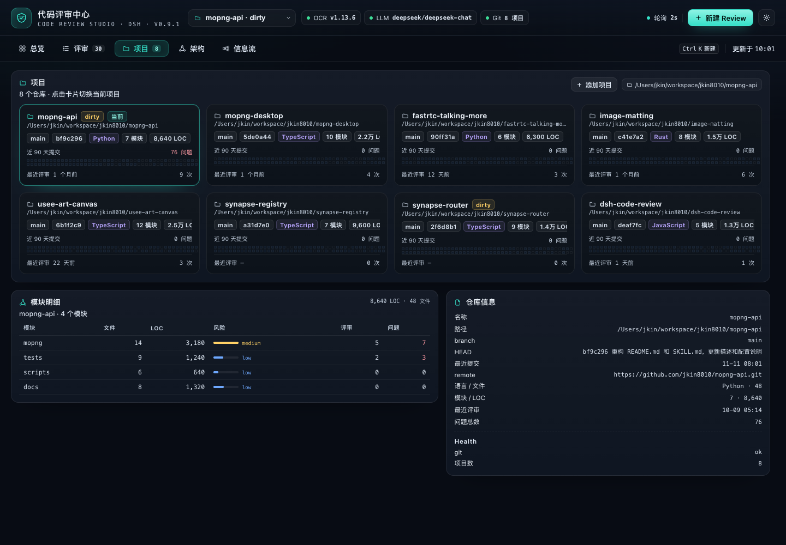
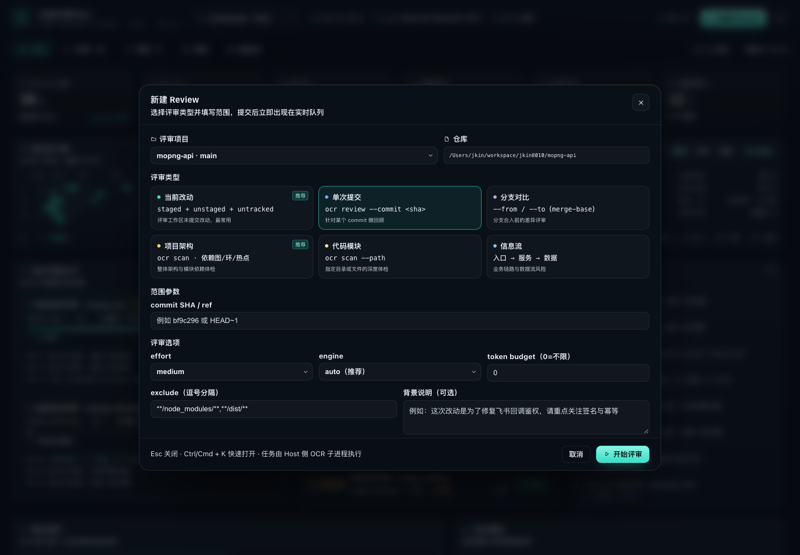
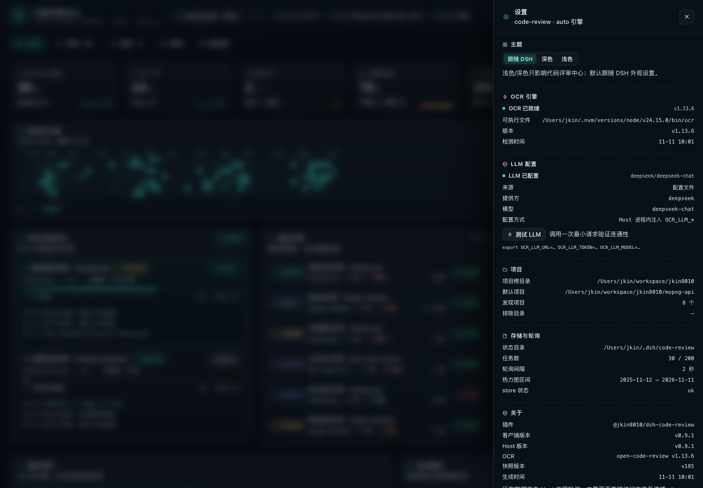
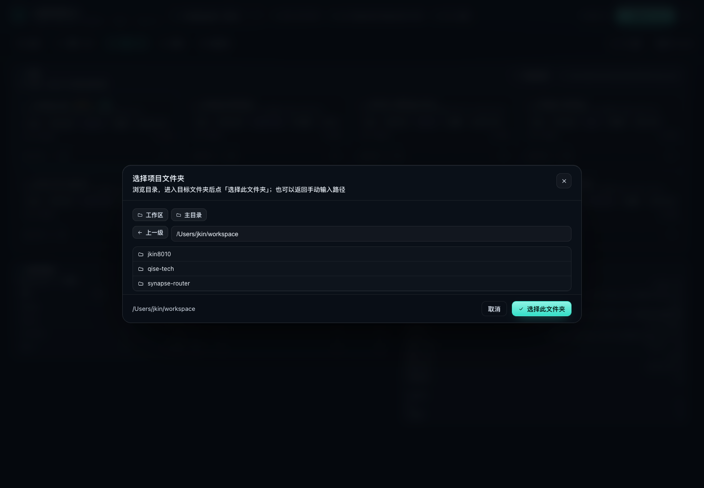

# dsh-code-review

English | [简体中文](README.zh.md)

> A DeepSeek Harness code review plugin built on [alibaba/open-code-review](https://github.com/alibaba/open-code-review):
> a sidebar entry plus a full-page **code review workbench** that brings the `ocr` CLI's AI review, local repository
> structural analysis and review history together into one actionable, traceable review center.

Four review types are supported: **current project changes / a specific commit / branch comparison**, **project architecture**,
**code modules**, and **business data-flow workflows**. Every review has live stage progress and an activity stream; open one to read
the per-finding results grouped by severity, the suggested-code diffs and the coverage. The overview page shows the past year's
commit and review rhythm as a GitHub-style heatmap and summarizes the projects and hotspot modules reviewed recently — all on one screen.

The implementation contract is documented in [docs/CODE-REVIEW-CONTRACT.md](docs/CODE-REVIEW-CONTRACT.md), and the
delivery and acceptance records in [docs/CODE-REVIEW-DELIVERY.md](docs/CODE-REVIEW-DELIVERY.md).

## Screenshots












> The screenshots are rendered by the standalone preview harness in `tests/code-review/preview/` (it loads the real `client.js` with contract mock data). The project list uses public repository names from [@jkin8010](https://github.com/jkin8010), and the review data is demo data.

## Features

- **Four review types**
  - **Current changes**: staged + unstaged + untracked (`ocr review`)
  - **Single commit / branch comparison**: `ocr review --commit`, `--from/--to`
  - **Project architecture**: multi-language import dependency graph, Tarjan cycle detection, layering / god modules / missing tests (local analysis + `ocr scan`)
  - **Code module**: whole-file review of a specified directory or file (`ocr scan --path`)
  - **Business data-flow workflow**: entry → service → data/external dependencies, checking validation, authorization, transactions, idempotency, timeouts and swallowed exceptions
- **Three engines, selected automatically**: `ocr` (OCR's bundled LLM), `delegate` (OCR selects files and resolves rules, the review runs on the current DSH session model — no extra API key) and `structural` (offline, zero LLM dependency, used automatically when no model is available). See [Engines](#engines).
- **Live and traceable**: a six-stage state machine per review, stage progress, activity stream, cancel and retry, plus automatic "interrupted" marking after a Host restart
- **GitHub-style heatmap**: 53 weeks × 7 days, three metrics (commits / reviews / findings), hover for that day's commits, additions and deletions, reviews and findings, plus streaks and the busiest day
- **Details and stats**: findings grouped by severity, file:line, side-by-side original vs. suggested code, copy suggestion; recently reviewed projects, hotspot modules, severity/category distribution, coverage
- **Light / dark themes**: follows the DSH appearance setting automatically; can be pinned to dark or light in the settings drawer. See [Themes](#themes).
- **Data-flow depth**: resolves TS/monorepo path aliases (`@/`, `~/`) and `.js`→`.ts` ESM imports, so it can trace into services and data access; when there are many entries the service/data nodes are kept first, and when a downstream link cannot be resolved the graph says why
- **Graph zoom / large-graph noise reduction**: the architecture dependency graph and the data-flow pipeline support **wheel zoom, drag pan, reset / fit**; very large data-flow graphs show at most 20 nodes per column with a "…" to expand the next batch
- **All-in-one page**: project page, architecture dependency graph, data-flow swimlane diagram, new-review dialog and settings drawer

### The page

- **Overview**: 6 core metrics (total reviews / last 7 days / in progress / findings / files reviewed / modules covered), a **one-year commit heatmap** (GitHub style, 53 weeks × 7 days, 5 color levels; hover for that day's commit count, added/deleted lines, review count and finding count, switchable between "commits / reviews / findings"), review streaks and the busiest day, a **live review queue** (stage progress bar + current stage + elapsed time + the latest 3 activity entries), recent reviews, recent projects (mini heatmaps), hotspot modules (risk color bars), and a cross-review activity timeline.
- **Reviews**: every review record, filterable and searchable by status / type / project; expand a row for its latest activity; click through to the details.
- **Details**: a stage timeline (resolve project → select files / structural analysis → AI review → merge and dedupe → generate report), the summary and coverage, findings grouped by severity (file:line, category, side-by-side original vs. suggested code, copy suggestion), a ranking of the files involved, the OCR session number, and rerun / cancel / delete.
- **Projects**: a grid of project cards (branch / HEAD / workspace status / primary language / module count / lines of code / mini heatmap / latest review); click to switch the current project.
- **Architecture**: module dependency graph (node size = lines of code, color = risk, cycles highlighted), module metrics table and structural findings.
- **Data flow**: a pipeline graph from entry → service → data/external dependency; click a node to see its related files and risks, plus a risk note for each pipeline.
- **New review**: project, the 6 review types, scope (commit / from-to / module path), effort, engine, exclusion rules, background notes.

## Review types

The four categories break down into six concrete review types:

| Type | Engine call | Description |
|---|---|---|
| Current changes `workspace` | `ocr review` | staged + unstaged + untracked; clearly reported when the working tree is clean |
| Single commit `commit` | `ocr review --commit` | the commit relative to its parent |
| Branch comparison `range` | `ocr review --from --to` | merge-base semantics |
| Project architecture `architecture` | local module graph + `ocr scan` | module dependencies, cycles, layering, god modules, missing tests; the scan anchors are entry points and manifest files |
| Code module `module` | local module metrics + `ocr scan --path` | whole-file review of the specified directory/file |
| Data flow `flow` | local pipeline extraction + `ocr scan` | entry→service→data/external dependency; checks validation, authorization, transactions, idempotency, timeouts, swallowed exceptions and data leaks |

## Engines

- **OCR (AI)** — needs a working LLM. The plugin probes `OCR_LLM_URL/OCR_LLM_TOKEN/OCR_LLM_MODEL`, `~/.opencodereview/config.json` or `ANTHROPIC_*`; they can also be supplied in the plugin config or a token file, and the token only exists in the Host process and is never sent back to the frontend.
- **Delegate mode (`delegate`)** — when OCR has no LLM configured but the current DSH session has a usable model, the plugin follows open-code-review's official delegation semantics: OCR still handles file selection and rule resolution, while the review is done by the DSH model (`ctx.llm.stream` + the default model), so no extra API key is needed. It works out of the box, and the results use the same finding structure as OCR.
- **Offline structural analysis (`structural`)** — zero LLM dependency, always available. When model-based review is unavailable it degrades to structural analysis automatically, says so in the review summary, and never fabricates AI conclusions.

With `engine: auto` (the default) the engine is resolved per review in this order: `ocr` when OCR owns a working LLM; `delegate` when OCR has no LLM configured but the current DSH session has a usable model; and `structural` otherwise. The `engine` config option accepts `auto`, `ocr` or `structural`.

## Themes

- Follows the DSH appearance (`data-theme`) by default and switches dark/light automatically
- The settings drawer can pin **Follow DSH / Dark / Light**; the choice is stored locally
- The light theme covers the whole page: background, cards, text, severity colors, charts, modals and inputs

## Host module boundaries

| Module | Responsibility |
|---|---|
| `index.js` | Assembly only: config normalization, service references, store/jobs/snapshot construction, tool/command/RPC registration, lifecycle |
| `host/rpc.js` | `/api/code-review` method dispatch and error envelope |
| `host/engine-plan.js` | Review engine selection (ocr / delegate / structural) |
| `host/service-refs.js` | Per-apply lazy references to `sessionController` / `workspaceRegistry` |
| `host/fix.js` | Fix session creation and prompt (shared by RPC and `--fix`) |
| `host/commands.js` | `/code-review` command parsing and execution |
| `host/llm-review.js` | Delegation-mode reviewer: asks the DSH session model for strict-JSON findings and degrades to the structural pass on failure |
| `host/snapshot.js` / `host/jobs.js` / `host/store.js` | Snapshot projection, job execution, on-disk persistence |

## Installation

DeepSeek Harness (with the Web UI), the `ocr` CLI ≥ 1.13, `git` and Node 22+ are required.

The repository root `package.json` is the single DSH bundle manifest (`dsh.bundle → cordis.patch.yml`), and the plugin code lives at the repository root — there is no `plugins/` subdirectory — so the plugin can be installed straight from the Git URL.

### One-click install (paste the prompt below into DSH)

```text
Please install the DSH plugin https://github.com/jkin8010/dsh-code-review: use plugin_manager's install_bundle to install this Git repository directly. When it finishes, check whether the plugin is enabled, run ocr --version, check the LLM engine status, and tell me whether DSH needs a restart.
```

> If `plugin_manager` returns `restart-required`, restart DSH to apply it; if it reports the change as applied, just refresh the page.

### Manual installation

```bash
# 1) Install the open-code-review CLI (optional; without it the plugin uses offline structural analysis)
npm i -g @alibaba-group/open-code-review

# 2) Install it in DSH (Plugins in the Web sidebar, or via the agent tool); these two targets are equivalent:
#    - Git URL:          https://github.com/jkin8010/dsh-code-review
#    - local clone root: /absolute/path/dsh-code-review
plugin_manager → action: install_bundle, target: https://github.com/jkin8010/dsh-code-review
```

> This plugin is a profile bundle; with HMR enabled it hot-loads (refresh the page and the sidebar entry appears), otherwise it takes effect after restarting DSH.
> The plugin itself has no third-party dependencies, so no extra `pnpm install` is needed.

### System dependencies

- `ocr` CLI ≥ 1.13: `npm i -g @alibaba-group/open-code-review` (the plugin also looks for it in the PATH / nvm / Homebrew directories)
- `git` (needed for repository-based reviews; non-Git directories can still use architecture / module / data-flow reviews)
- For AI review you also need to configure an LLM for OCR (see below; optional — without one the plugin uses `delegate` or offline structural analysis)

### Configuring an LLM for OCR (optional)

By default `ocr` needs an LLM to do AI review; when none is configured the plugin automatically uses `delegate` (the current DSH model) or `structural` (offline analysis).

```bash
ocr config provider    # pick a provider and enter the API key
ocr config model
ocr llm test           # verify connectivity
```

## Configuration (`cordis.patch.yml`, all optional)

```yaml
- insert:
    - id: qise-code-review
      name: '@jkin8010/dsh-code-review'
      config:
        projectRoots: [/Users/you/workspace]     # repositories to auto-discover (2 levels deep by default)
        projectDepth: 2                          # directory scan depth, 1-3
        maxProjects: 40                          # maximum number of projects to include
        extraProjects: [/Users/you/current/repo] # extra projects to include (may be non-Git)
        defaultProjectPath: ''                   # empty = the most recently committed discovered project
        excludeProjects: []
        stateDir: ~/.dsh/code-review             # review history / artifacts
        engine: auto                             # auto | ocr | structural
        pollSeconds: 2
        heatmapDays: 365
        maxJobs: 200
        ocr:
          command: ''            # empty = auto-detect
          provider: ''           # passed through as --provider
          model: ''              # passed through as --model
          llmUrl: ''             # injects OCR_LLM_URL
          llmToken: ''           # injects OCR_LLM_TOKEN (llmTokenFile works too)
          llmTokenFile: ''       # read the token from a file instead of writing it into the config
          effort: medium         # low | medium | high
          concurrency: 8
          timeoutMin: 15
          maxTokens: 0
          maxTokensBudget: 0
          extraArgs: []
```

The block above is the full option reference (values are examples). The `cordis.patch.yml` shipped in this repository only sets the project-discovery and OCR basics — every option is optional, and anything you omit falls back to the built-in default. Override what you need in your profile config.

## Usage

### Review directly from a project conversation (recommended)

The plugin registers the model tool **`code_review`** (active after install/restart). In any project session you can simply say:

- "Review the architecture of the current project with the code review center"
- "Review the current changes, only high and above"
- "Review the `host` module"
- "Review this project's message pipeline from a data-flow perspective"
- "Show me the details of the most recent review"

Copy the line below to kick off a full review in one go:

```text
Review the current project with the code review center: start with the project architecture, then review the host module, and finally review the message pipeline from a data-flow perspective; anything below high can be skipped.
```

The Agent calls `code_review` → `start` (waiting for the review to finish by default) → and returns the issue summary and findings in the conversation; the full grouping, code suggestions and coverage remain available in the "Code Review Center" in the sidebar.
`action=status/detail/list` queries progress and history, and `wait:false` runs in the background so you can fetch the result afterwards.

Tool arguments (the Agent fills them in automatically, but you can also ask for them directly):

| Argument | Description |
|---|---|
| `action` | `start` / `status` / `detail` / `list` |
| `project_path` | Omitted = the current session working directory (the current project) |
| `type` | `workspace` / `commit` / `range` / `architecture` / `module` / `flow`; when omitted, supplying `paths` means a module review, otherwise a project architecture review |
| `scope` | `paths` (module) / `commit` / `from`+`to` |
| `options` | `effort`, `background`, `exclude`, `max_tokens_budget` |
| `wait` | Defaults to `true` and waits for completion; `false` returns a job id immediately |
| `job_id` / `severity` / `limit` | Used when querying details |

> If you would rather not wait, say "run it in the background and tell me when it's done"; the Agent will use `wait:false` and fetch the result later with `status`/`detail`.

### Slash command `/code-review`

Besides having the Agent call the tool, you can also use slash commands right in the input box (mirroring the ocr CLI review types):

```text
/code-review workflow @test/                    # add test/ as a project and run the data-flow review
/code-review workflow --fix @test/              # same as above, then open a fix session automatically
/code-review architecture @/Users/me/proj       # project architecture
/code-review module src/server,src/db --fix     # code module + fix session
/code-review module --paths src/server,src/db --fix   # equivalent form
/code-review module @host                       # the host directory inside the current project
/code-review changes --effort high              # current changes
/code-review commit abc123
/code-review range main feature/login
/code-review fix [jobId]                        # open a fix session for the most recent review
/code-review list / status [jobId]
```

- `@path` or `--project path`: **works even when the project is not in the list yet** — the command adds it as a project first, then runs the review;
  relative paths resolve against the current session directory
- `--fix`: opens a fix session in the project directory and sends it the findings once the review finishes
- `--async`: returns immediately after starting; `--effort` / `--background` / `--exclude` / `--budget` map to the review options
- With no subcommand, or with `help`, it prints the full usage

### Using it in the page

1. Open "Code Review Center" in the left sidebar and pick a project at the top (`projectRoots` auto-discovery + `extraProjects`).
2. Click "New Review" and choose a type:
   - Current changes / single commit / branch comparison: fill in the commit or from/to
   - Project architecture / code module / data flow: for a module review fill in the directory path; the data-flow review can be left empty for auto-discovery
3. After submitting, watch the stage progress and activity in the overview's "Live review queue", then click through to the details for the findings.
4. The overview heatmap and "recent projects / hotspot modules" track the review rhythm; the project page lets you switch the current project.
5. **The project list automatically includes**: Git repositories under `projectRoots` (default `/Users/jkin/workspace`, 2 levels deep), DSH workspaces, and projects that have already been reviewed (even if they are not under `projectRoots`).

### Any project



- The project dropdown, "Add project" on the project page, and the project dropdown in New Review all offer "＋ Add project path…"
- Either the built-in folder browser (list directory / go up one level / select the current folder) or a manually typed absolute path; both Git repositories and plain directories work
- Project sources are also merged automatically: repositories found 2 levels below `projectRoots`, DSH workspaces, and already reviewed projects; additions are persisted in `<stateDir>/projects.json`

### Fixed markers

- Every finding on the review details page has "Mark as fixed / Unmark fixed", and the filter on the right switches between **All / Unfixed / Fixed**
- The header and the list show `Fixed X / Unfixed Y`, finding cards carry a green "Fixed" badge, and the Markdown export includes the fix status
- Markers are persisted in the job file (`resolutions`) and survive refreshes and restarts
- When a new review with the same project, review type and scope no longer reports an old finding, the old report is marked as fixed **automatically**
- After a fix session was started from a report, reopening it automatically re-runs the same scope to verify fixes (or use the "Verify fixes" button); findings that no longer appear are marked fixed

### One-click fix session

The review details page offers "New fix session": it creates a session in the project Workspace and fills the findings
(critical/high first, including files and line numbers, with the suggested code) into the composer as a **fix prompt draft**;
press Enter to send (edit first if needed). `/code-review --fix` and the fix-session RPC use the Host auto-send path.

> This requires DSH to provide `sessionController`; when the Host is older (not restarted yet) the client falls back to
> DSH Client Remote's `session.create` / `session.prompt` to create the session, and prompts you to restart DSH to enable the full mode.
> The settings drawer also shows any client/Host version mismatch — fully quit and reopen DSH to load the new Host.

## Repository structure

```
package.json                    # single DSH bundle manifest: dsh.bundle → cordis.patch.yml
cordis.patch.yml                # bundle default config
icon.svg                        # plugin / sidebar icon
index.js                        # Host entry: /api/code-review RPC, lifecycle, dependency wiring
client.js                       # full-page Web UI (React.createElement, no build step)
host/                           # Host implementation
  rpc.js                        # /api/code-review dispatch + failure envelope
  engine-plan.js                # engine selection (ocr / delegate / structural)
  service-refs.js               # per-apply sessionController / workspaceRegistry refs
  lifecycle.js                  # startup, timers, disposal
  fix.js                        # fix-session creation and prompt
  commands.js                   # /code-review slash command
  tool.js                       # code_review model tool
  config.js                     # config normalization / ocr probing / env injection
  shared.js                     # Finding normalization, date and stat helpers
  store.js                      # review history persistence (index + details + stats + activity)
  files.js                      # source file traversal
  prompts.js                    # OCR background / rule / title prompts
  jobs.js                       # review state machine (6 stages) and engine merge
  llm-review.js                 # delegation-mode reviewer (DSH session model)
  snapshot.js                   # snapshot construction (projects / heatmap / stats / health)
  git.js                        # project discovery, git metadata, one-year heatmap, module tree
  ocr.js                        # ocr CLI adapter (preview/review/scan/cancel/progress/failure classification)
  analyze.js                    # architecture / module / data-flow / diff offline analysis
locale/                         # sidebar and settings copy (en / zh)
screenshots/                    # UI screenshots
tests/code-review/              # self-tests (real git/ocr + fake Cordis/LLM) and the screenshot harness
docs/CODE-REVIEW-CONTRACT.md    # field/API contract between the plugin and the front/back end
docs/CODE-REVIEW-DELIVERY.md    # delivery and acceptance records, plus known limitations
docs/RELEASE-HISTORY.md         # archived notes for releases whose tags were cleaned up
assets/icon-512.png             # 512px icon
LICENSE                         # Apache-2.0
```

## Verification

All test commands run from the repository root:

```bash
node tests/code-review/engine-selftest.mjs     # four review types + snapshots + persistence (fake adapters, no LLM needed)
node tests/code-review/delegate-selftest.mjs   # delegate mode: OCR file selection + DSH model review (fake llm)
node tests/code-review/host-selftest.mjs       # real git/ocr/analyze + a fake Cordis router, exercising the full RPC chain
node tests/code-review/git-ocr.test.mjs        # git/heatmap + ocr preview (real repository; 33 cases)
node tests/code-review/analyze.test.mjs        # architecture/module/data-flow/diff analysis (node:test; 10 cases)
node tests/code-review/tool-selftest.mjs       # conversational code_review tool start/status/detail/list
node tests/code-review/preview/shoot.mjs       # render the real client.js, screenshots + DOM assertions
```

## Data sources (all read-only except the plugin's own stateDir)

| Source | How it is read |
|---|---|
| Projects / commit heatmap | `git log --numstat --date=short` (one pass, aggregated by day, missing days filled with 0), `git ls-files`, `git status --porcelain` |
| Changes / branch / commit range | `ocr review --preview` (no LLM call), then the real review |
| Whole-file review | `ocr scan --path` |
| Architecture / data flow | local static analysis (import graph, Tarjan cycles, entry detection, ORM/SQL/external call detection) |
| Review history | `<stateDir>/index.json`, `jobs/<id>.json`, `stats.json`, `activity.json` |

Polling: the frontend pulls a snapshot every 2s by default; the Host caches project info (5min), the current project's heatmap (1min) and OCR health (1min), so polling never re-hits git / ocr.

## Reliability

- A missing `ocr`, an unconfigured LLM, a non-Git project or an unreadable repository all degrade into a readable state with a next step, never a blank screen.
- Review jobs can be cancelled (subprocess SIGTERM→SIGKILL), failures can be retried, and jobs left running after a Host restart are marked interrupted automatically.
- Finding dedupe: when structural analysis and the AI hit the same problem, the two are merged and the AI wording is kept.
- Persistence uses atomic writes (tmp + rename); the index stores summaries only and findings are loaded on demand.

## Design notes

- The Host owns all I/O: `git` / `ocr` subprocesses / persistence; the frontend only polls a single authenticated RPC snapshot (every 2s),
  and the Host caches projects, the heatmap and OCR health so polling never re-hits the upstream.
- Six-stage review state machine: `resolve → plan → structure → ai → merge → report`;
  if the AI stage fails or is unconfigured, it degrades to offline structural analysis and never fabricates conclusions.
- Review history is written atomically to `~/.dsh/code-review/` (index + details + daily stats + activity) and restored automatically on restart.
- Cancellation: `SIGTERM → 2s → SIGKILL`; retrying creates a new job; failure classes are actionable.

## Known limitations

- Offline analysis is heuristic (not AST), so call chains in dynamic languages are only linked one level deep; the data-flow graph is capped at 40 nodes.
- Current-change/commit/branch reviews need a Git repository; non-Git directories can still get architecture/module/data-flow reviews.
- The heatmap window is `today-(days-1)` in local time, so crossing a timezone boundary can be off by one day.
- `language` only recognizes the built-in extension table; full inspect is capped at 4000 files, and LOC skips binaries and files larger than 2MB.

## License

[Apache-2.0](LICENSE). The `ocr` engine comes from [alibaba/open-code-review](https://github.com/alibaba/open-code-review) (Apache-2.0).
