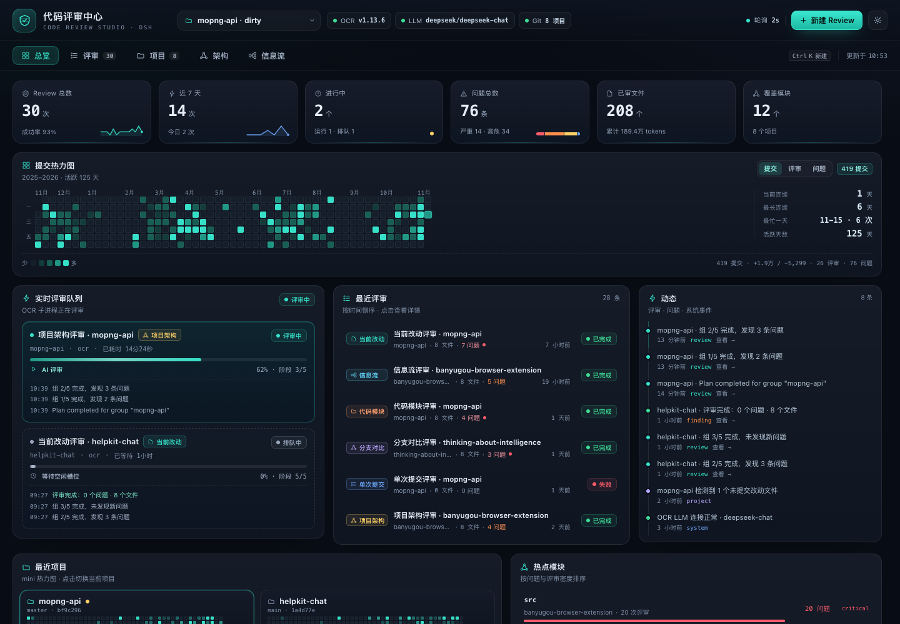
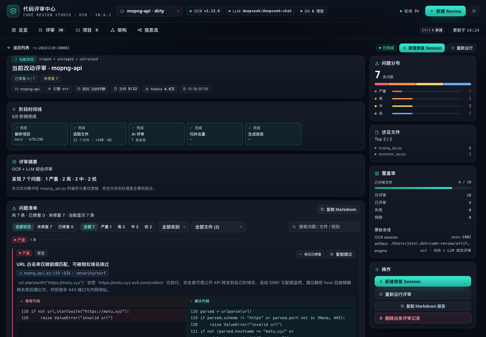
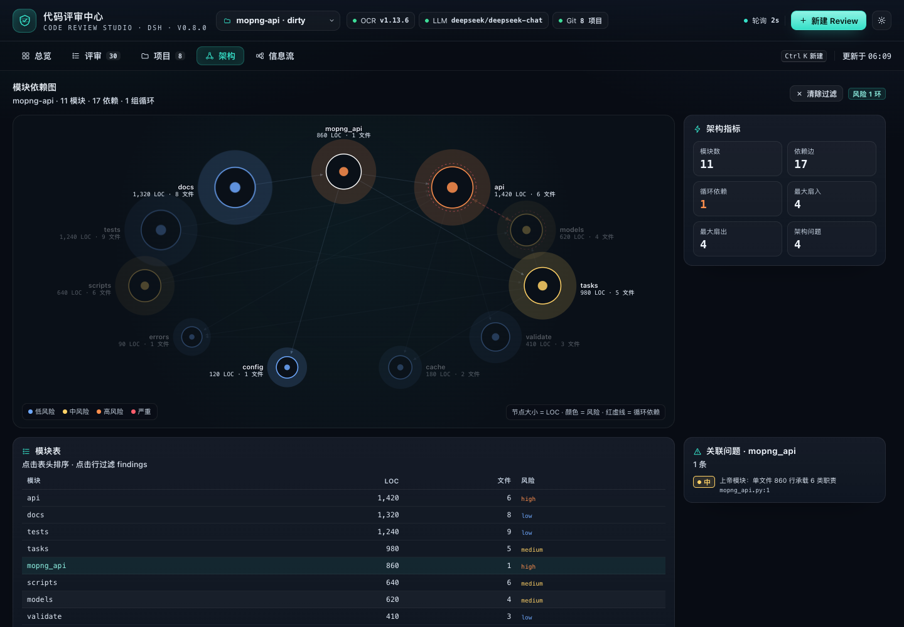
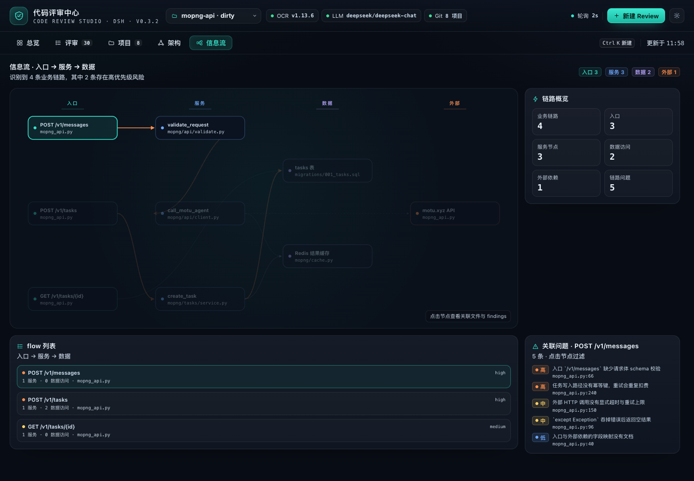
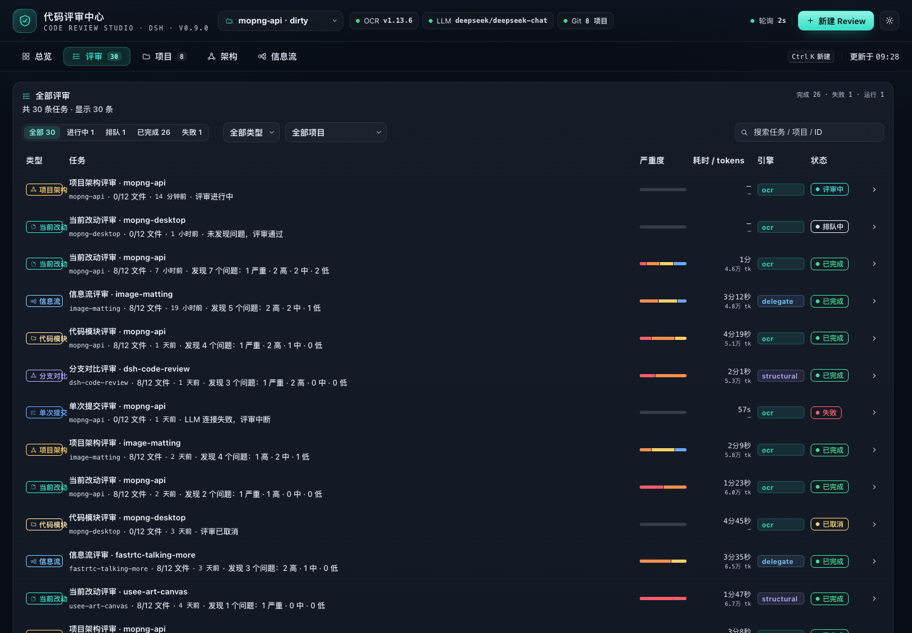
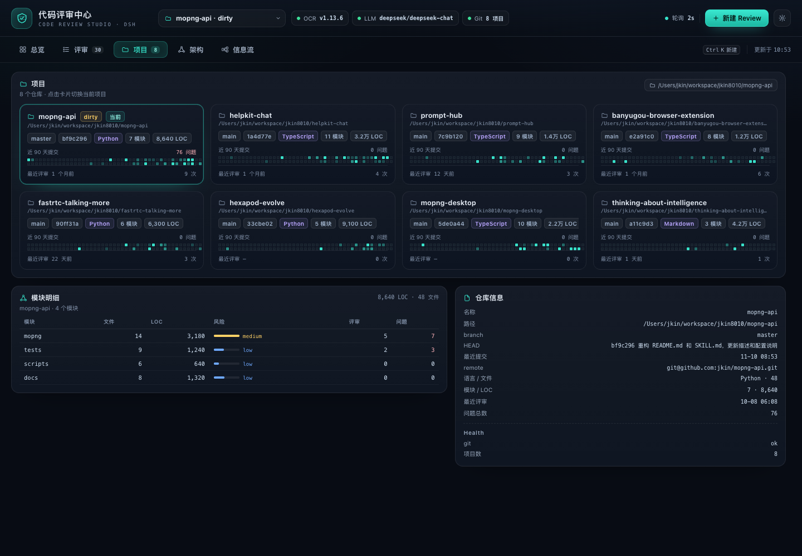
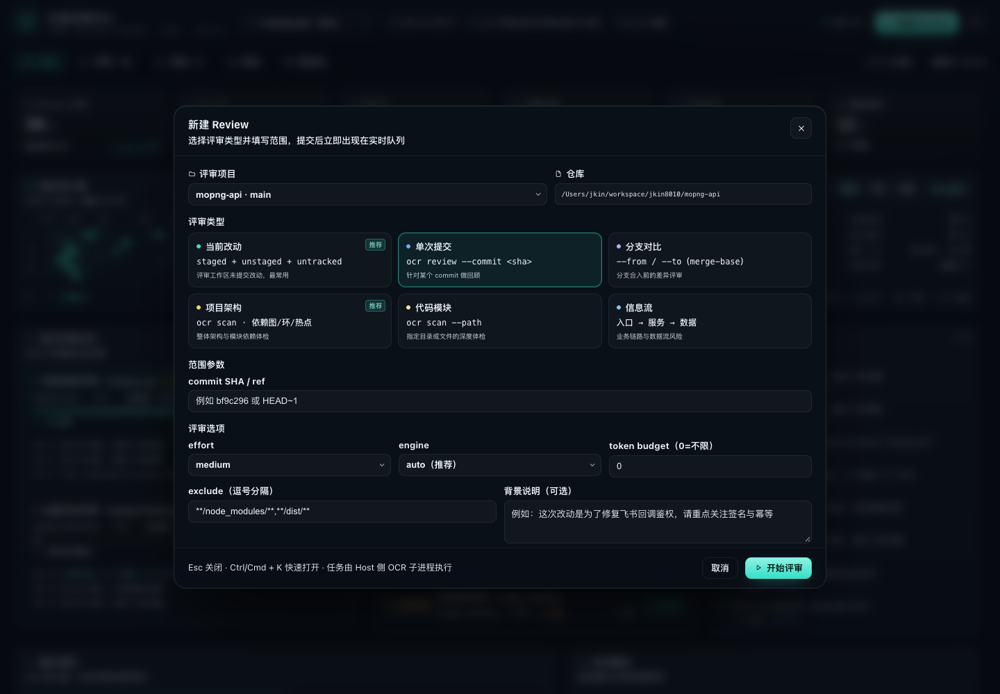
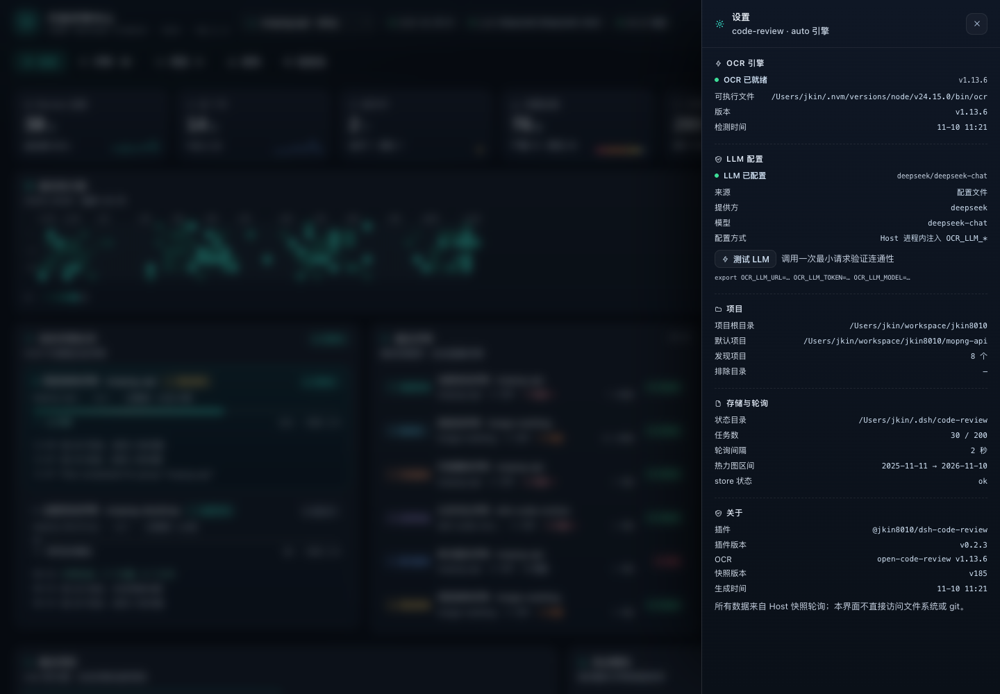

# Code Review Center (@jkin8010/dsh-code-review)

English | [简体中文](README.zh.md)

A DSH sidebar entry plus a full-page **code review workbench**: it brings the AI review capabilities of
[alibaba/open-code-review](https://github.com/alibaba/open-code-review) (the `ocr` CLI), local repository structural analysis
and review history together into one actionable, traceable review center.

Four review types are supported: **current project changes / a specific commit / branch comparison**, **project architecture**,
**code modules**, and **business data-flow workflows**.
Every review has live stage progress and an activity stream; open one to read the per-finding results grouped by severity,
the suggested-code diffs and the coverage;
the overview page shows the past year's commit and review rhythm as a GitHub-style heatmap, and summarizes the projects and hotspot modules reviewed recently.










> The implementation contract is documented in [docs/CODE-REVIEW-CONTRACT.md](../../docs/CODE-REVIEW-CONTRACT.md),
> and the delivery and acceptance records in [docs/CODE-REVIEW-DELIVERY.md](../../docs/CODE-REVIEW-DELIVERY.md).

> The screenshots come from the standalone preview harness in `tests/code-review/preview/` (it loads the real `client.js` with contract mock data).

---

## Any project

- The project dropdown, "Add project" on the project page, and the project dropdown in New Review all offer "＋ Add project path…"
- Either the built-in folder browser (list directory / go up one level / select the current folder) or a manually typed absolute path; both Git repositories and plain directories work
- Project sources are also merged automatically: repositories found 2 levels below projectRoots, DSH workspaces, and already reviewed projects

## Using it from a project conversation

After install/restart the plugin registers the model tool **`code_review`**, so in any project session you can just say:

- "Review the architecture of the current project with the code review center"
- "Review the current changes, only high and above"
- "Review the `host` module"
- "Review the message pipeline from a data-flow perspective"
- "Show me the details of the most recent review"

The Agent starts a real review (waiting for completion by default) and returns the issue summary and findings in the conversation; the full details are on the sidebar page.
`action=status/detail/list` queries progress and history, and `wait:false` runs in the background so you can fetch the result afterwards.

## Host module boundaries

| Module | Responsibility |
|---|---|
| `index.js` | Assembly only: config normalization, service references, store/jobs/snapshot construction, tool/command/RPC registration, lifecycle |
| `host/rpc.js` | `/api/code-review` method dispatch and error envelope |
| `host/engine-plan.js` | Review engine selection (ocr / delegate / structural) |
| `host/service-refs.js` | Per-apply lazy references to `sessionController` / `workspaceRegistry` |
| `host/fix.js` | Fix session creation and prompt (shared by RPC and `--fix`) |
| `host/commands.js` | `/code-review` command parsing and execution |
| `host/snapshot.js` / `host/jobs.js` / `host/store.js` | Snapshot projection, job execution, on-disk persistence |

## Slash command `/code-review`

Available directly in a project conversation (mirroring the ocr CLI review types):

```text
/code-review workflow @test/
/code-review workflow --fix @test/
/code-review architecture
/code-review module host,client --fix
/code-review changes --effort high
/code-review commit <sha>
/code-review range main feature/x
/code-review fix [jobId]
/code-review list | status [jobId]
```

`@path` / `--project` first adds the project to the project list and then reviews it (so it also works when no projects are configured), and relative paths resolve against the session cwd;
`--fix` opens a fix session automatically after the review; `--async` returns immediately.

## Fixed markers

- Every finding on the review details page has "Mark as fixed / Unmark fixed", and the filter on the right switches between **All / Unfixed / Fixed**
- The header and the list show `Fixed X / Unfixed Y`, finding cards carry a green "Fixed" badge, and the Markdown export includes the fix status
- Markers are persisted in the job file (`resolutions`) and survive refreshes and restarts
- When a new review with the same project, review type and scope no longer reports an old finding, the old report is marked as fixed **automatically**

## One-click fix session

The review details page offers "New fix session": it calls the Host's `sessionController.create({ cwd })` to create a session in the project directory,
turns this review's findings into a fix prompt (critical/high first, including files and line numbers, with the suggested code) and sends it automatically;
when the client supports `uiWorkspace.openSession` it jumps straight to the new session, otherwise open it from the session list on the left.

> This requires DSH to provide `sessionController`; when the Host is older (not restarted yet) the client falls back to
> DSH Client Remote's `session.create` / `session.prompt` to create the session, and prompts you to restart DSH to enable the full mode.

## What you get

- **Overview**: 6 core metrics (total reviews / last 7 days / in progress / findings / files reviewed / modules covered),
  a **one-year commit heatmap** (GitHub style, 53 weeks × 7 days, 5 color levels; hover for that day's commit count, added/deleted lines, review count and finding count,
  switchable between "commits / reviews / findings"), review streaks and the busiest day, a **live review queue** (stage progress bar + current stage + elapsed time + the latest 3 activity entries),
  recent reviews, recent projects (mini heatmaps), hotspot modules (risk color bars), and a cross-review activity timeline.
- **Reviews**: every review record, filterable and searchable by status / type / project; expand a row for its latest activity; click through to the details.
- **Details**: a stage timeline (resolve project → select files / structural analysis → AI review → merge and dedupe → generate report),
  the summary and coverage, findings grouped by severity (file:line, category, side-by-side original vs. suggested code, copy suggestion),
  a ranking of the files involved, the OCR session number, and rerun / cancel / delete.
- **Projects**: a grid of project cards (branch / HEAD / workspace status / primary language / module count / lines of code / mini heatmap / latest review); click to switch the current project.
- **Architecture**: module dependency graph (node size = lines of code, color = risk, cycles highlighted), module metrics table and structural findings.
- **Data flow**: a pipeline graph from entry → service → data/external dependency; click a node to see its related files and risks, plus a risk note for each pipeline.
- **New review**: project, the 6 review types, scope (commit / from-to / module path), effort, engine, exclusion rules, background notes.

## Review types

| Type | Engine call | Description |
|---|---|---|
| Current changes `workspace` | `ocr review` | staged + unstaged + untracked; clearly reported when the working tree is clean |
| Single commit `commit` | `ocr review --commit` | the commit relative to its parent |
| Branch comparison `range` | `ocr review --from --to` | merge-base semantics |
| Project architecture `architecture` | local module graph + `ocr scan` | module dependencies, cycles, layering, god modules, missing tests; the scan anchors are entry points and manifest files |
| Code module `module` | local module metrics + `ocr scan --path` | whole-file review of the specified directory/file |
| Data flow `flow` | local pipeline extraction + `ocr scan` | entry→service→data/external dependency; checks validation, authorization, transactions, idempotency, timeouts, swallowed exceptions and data leaks |

Two engines:

- **OCR (AI)**: needs a working LLM. The plugin probes `OCR_LLM_URL/OCR_LLM_TOKEN/OCR_LLM_MODEL`,
  `~/.opencodereview/config.json` or `ANTHROPIC_*`; they can also be supplied in the plugin config or a token file, and the token only exists in the Host process and is never sent back to the frontend.
- **Delegate mode (delegate)**: when OCR has no LLM configured but the current DSH session has a usable model, the plugin follows open-code-review's official
  delegation semantics — OCR still handles file selection and rule resolution, while the review is done by the DSH model (`ctx.llm.stream` + the default model),
  so no extra API key is needed. It works out of the box, and the results use the same finding structure as OCR.
- **Offline structural analysis**: zero LLM dependency, always available. When model-based review is unavailable it degrades to structural analysis automatically, says so in the review summary, and never fabricates AI conclusions.

## Installation

### One-click install (paste the prompt below into DSH)

```text
Please install the DSH plugin https://github.com/jkin8010/dsh-code-review: use plugin_manager's install_bundle to install this Git repository directly. When it finishes, check whether the plugin is enabled, run ocr --version, check the LLM engine status, and tell me whether DSH needs a restart.
```

### Manual installation

```text
# In DSH (Plugins in the Web sidebar, or the agent tool):
plugin_manager → action: install_bundle
                 target: https://github.com/jkin8010/dsh-code-review
# or, after cloning locally, target: <absolute path to the repository root>
# The repository root package.json is the bundle manifest; this directory is the plugin implementation its exports point to.
```

> This plugin is a profile bundle; with HMR enabled no restart is needed — refresh the page and the sidebar entry appears.

System dependencies:

- `ocr` CLI ≥ 1.13: `npm i -g @alibaba-group/open-code-review` (the plugin also looks for it in the PATH / nvm / Homebrew directories)
- `git` (needed for repository-based reviews; non-Git directories can still use architecture / module / data-flow reviews)
- For AI review you also need to configure an LLM for OCR (see above)

## Configuration (`cordis.patch.yml`, all optional)

```yaml
- insert:
    - id: qise-code-review
      name: '@jkin8010/dsh-code-review'
      config:
        projectRoots: [/Users/jkin/workspace]   # repositories to auto-discover (2 levels deep by default)
        projectDepth: 2                          # directory scan depth, 1-3
        maxProjects: 40                          # maximum number of projects to include
        extraProjects: []                        # extra projects to include (may be non-Git)
        defaultProjectPath: ''                            # empty = the most recently committed discovered project
        excludeProjects: []
        stateDir: ~/.dsh/code-review                      # review history / artifacts
        engine: auto                                      # auto | ocr | structural
        pollSeconds: 2
        heatmapDays: 365
        maxJobs: 200
        ocr:
          command: ''            # empty = auto-detect
          provider: ''           # passed through as --provider
          model: ''              # passed through as --model
          llmUrl: ''             # injects OCR_LLM_URL
          llmToken: ''           # injects OCR_LLM_TOKEN (llmTokenFile works too)
          llmTokenFile: ''       # read the token from a file instead of writing it into the config
          effort: medium         # low | medium | high
          concurrency: 8
          timeoutMin: 15
          maxTokens: 0
          maxTokensBudget: 0
          extraArgs: []
```

## Data sources (all read-only except the plugin's own stateDir)

| Source | How it is read |
|---|---|
| Projects / commit heatmap | `git log --numstat --date=short` (one pass, aggregated by day, missing days filled with 0), `git ls-files`, `git status --porcelain` |
| Changes / branch / commit range | `ocr review --preview` (no LLM call), then the real review |
| Whole-file review | `ocr scan --path` |
| Architecture / data flow | local static analysis (import graph, Tarjan cycles, entry detection, ORM/SQL/external call detection) |
| Review history | `<stateDir>/index.json`, `jobs/<id>.json`, `stats.json`, `activity.json` |

Polling: the frontend pulls a snapshot every 2s by default; the Host caches project info (5min), the current project's heatmap (1min) and OCR health (1min),
so polling never re-hits git / ocr.

## Reliability

- A missing `ocr`, an unconfigured LLM, a non-Git project or an unreadable repository all degrade into a readable state with a next step, never a blank screen.
- Review jobs can be cancelled (subprocess SIGTERM→SIGKILL), failures can be retried, and jobs left running after a Host restart are marked interrupted automatically.
- Finding dedupe: when structural analysis and the AI hit the same problem, the two are merged and the AI wording is kept.
- Persistence uses atomic writes (tmp + rename); the index stores summaries only and findings are loaded on demand.

## Self-checks

```bash
node ../../tests/code-review/engine-selftest.mjs     # four review types + snapshots + persistence (fake adapters, no LLM needed)
node ../../tests/code-review/delegate-selftest.mjs   # delegate mode: OCR file selection + DSH model review (fake llm)
node ../../tests/code-review/host-selftest.mjs       # real git/ocr/analyze + a fake Cordis router, exercising the full RPC chain
node ../../tests/code-review/git-ocr.test.mjs        # git/heatmap + ocr preview (real repository)
node ../../tests/code-review/analyze.test.mjs        # architecture/module/data-flow analysis (node:test)
node ../../tests/code-review/preview/shoot.mjs       # render the real client.js and take screenshots
```

## Layout

```
plugins/dsh-code-review/
  index.js            Host entry: RPC / lifecycle / dependency wiring
  client.js           full-page Web UI (React.createElement, no build step)
  host/
    rpc.js            /api/code-review dispatch + failure envelope
    engine-plan.js    engine selection (ocr / delegate / structural)
    service-refs.js   per-apply sessionController / workspaceRegistry refs
    lifecycle.js      startup, timers, disposal
    fix.js            fix-session creation and prompt
    commands.js       /code-review slash command
    tool.js           code_review model tool
    config.js         config normalization / ocr probing / env injection
    shared.js         Finding normalization, date and stat helpers
    store.js          review history persistence (index + details + stats + activity)
    files.js          source file traversal
    prompts.js        OCR background / rule / title
    jobs.js           review state machine (6 stages) and dual-engine merge
    snapshot.js       snapshot construction (projects/heatmap/stats/health)
    git.js            project discovery, git metadata, one-year heatmap, module tree
    ocr.js            ocr CLI adapter (preview/review/scan/cancel/progress/failure classification)
    analyze.js        architecture / module / data-flow / diff offline analysis
  locale/             sidebar and settings copy
  tests/code-review/  self-checks, preview harness, screenshots
```

## License

Apache-2.0
