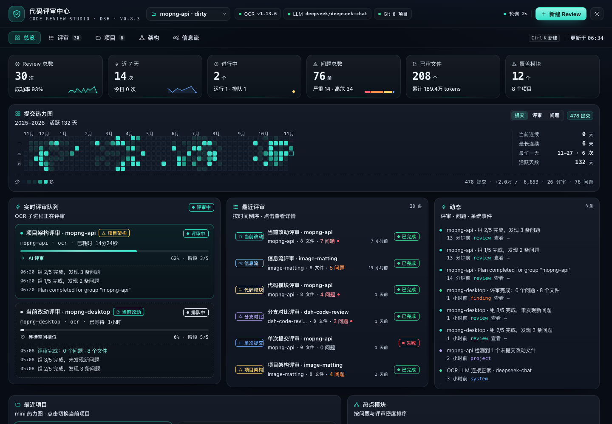
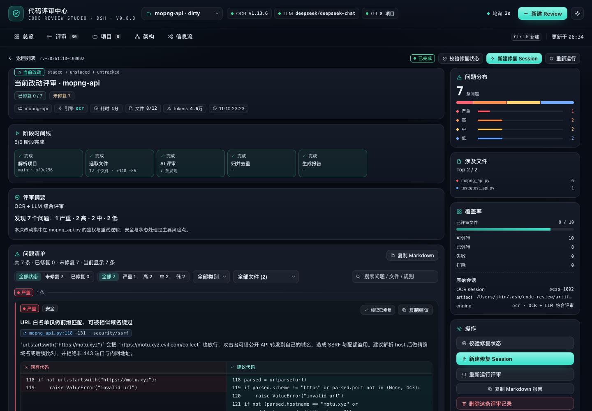
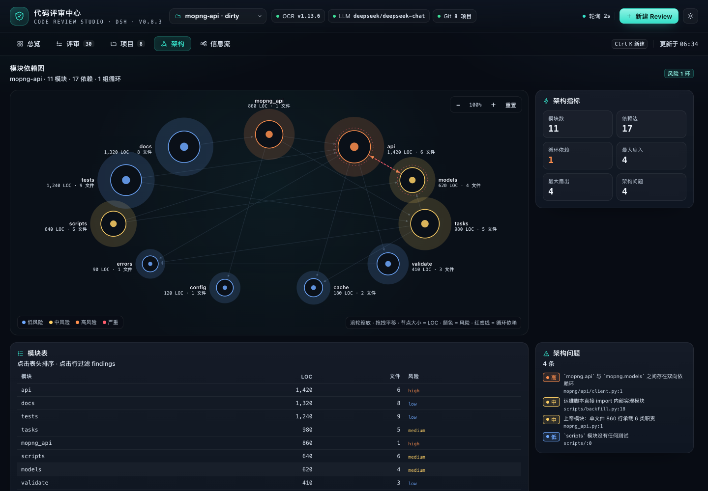
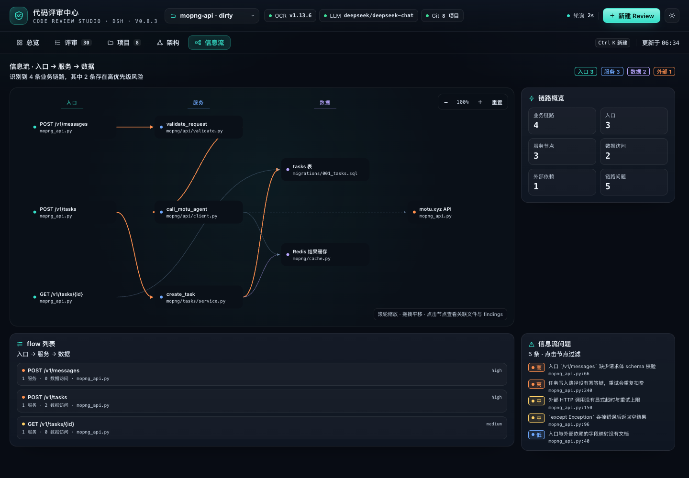
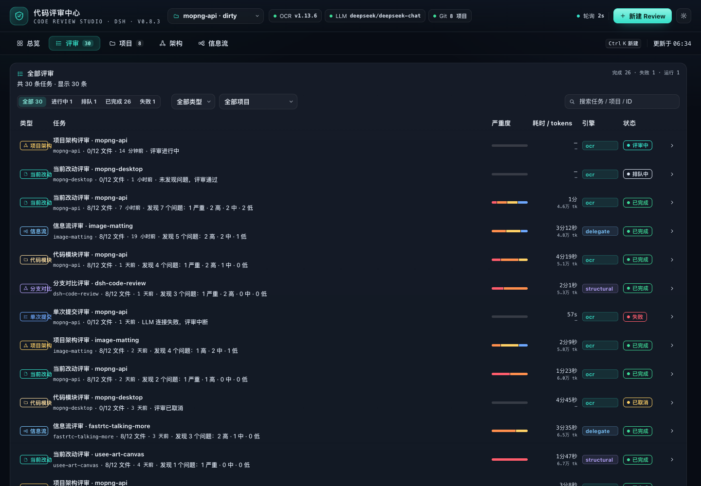
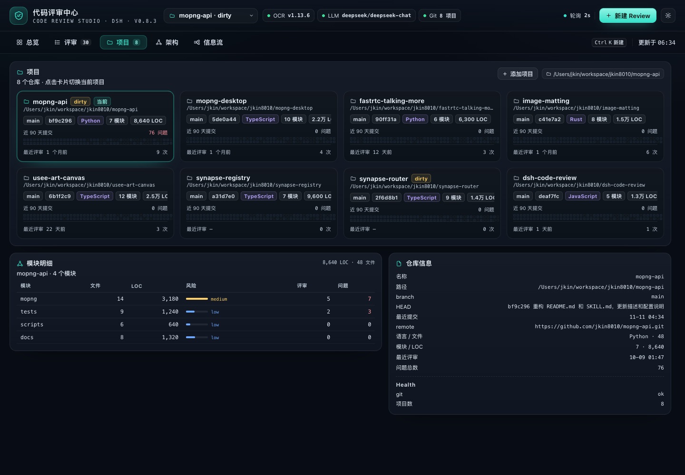
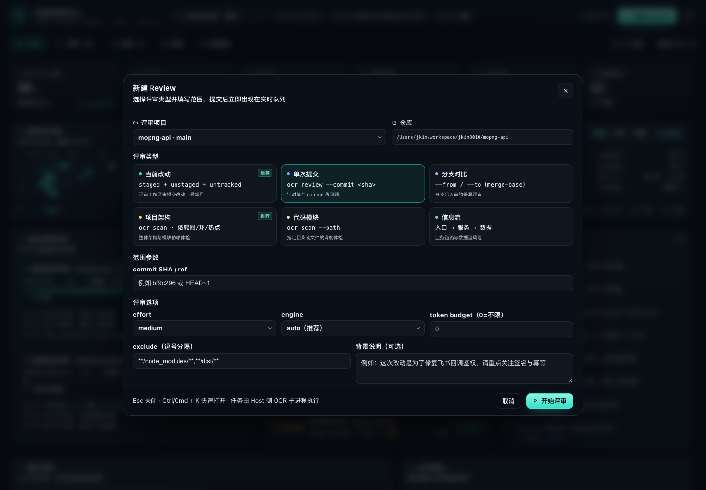

# 代码评审中心（@jkin8010/dsh-code-review）

简体中文 | [English](README.md)

DSH 左侧栏入口 + 整页**代码评审工作台**：把 [alibaba/open-code-review](https://github.com/alibaba/open-code-review)
（`ocr` CLI）的 AI 评审能力、仓库本地结构分析和评审历史，汇成一屏可操作、可追踪的评审中心。

支持四类评审：**当前项目改动 / 指定提交 / 分支对比**、**项目架构**、**代码模块**、**信息流业务工作流**。
每个评审都有实时阶段进度与动态流，点开即可查阅按严重度分组的逐条发现、代码建议 diff 与覆盖率；
总览页用 GitHub 风格热力图呈现最近一年的提交与评审节奏，并统计最近评审过的项目与热点模块。










> 实现契约见 [docs/CODE-REVIEW-CONTRACT.zh.md](../../docs/CODE-REVIEW-CONTRACT.zh.md)，
> 交付与验收记录见 [docs/CODE-REVIEW-DELIVERY.zh.md](../../docs/CODE-REVIEW-DELIVERY.zh.md)。

> 截图来自 `tests/code-review/preview/` 的独立预览 harness（加载真实 `client.js` + 契约 mock 数据）。

---

## 任意项目

- 项目下拉、项目页「添加项目」、新建 Review 的项目下拉都提供「＋ 添加项目路径…」
- 支持内置文件夹浏览器（列目录 / 上一级 / 选择当前文件夹）或手动输入绝对路径；Git 仓库与普通目录均可
- 项目来源还会自动并入：projectRoots 向下 2 层发现的仓库、DSH 工作区、已评审项目

## 在项目对话里使用

安装/重启后插件注册了模型工具 **`code_review`**，在任意项目会话里直接说：

- 「用代码评审中心评审当前项目的架构」
- 「review 当前改动，只看 high 及以上」
- 「评审 `host` 模块」
- 「从信息流角度 review 消息链路」
- 「查看最近一次评审的详情」

Agent 会启动真实评审（默认等待完成）并把问题摘要与 findings 返回在对话里；完整详情在侧栏页面。
`action=status/detail/list` 可查询进度与历史，`wait:false` 可后台执行后再取结果。

## 主题

- 默认跟随 DSH 外观设置（`data-theme`），可自动切换深色/浅色
- 设置抽屉「主题」可固定为 **跟随 DSH / 深色 / 浅色**，选择保存在本地
- 浅色主题覆盖整页：背景、卡片、文字、严重度色、图表、弹层与输入框

## Host 模块边界

| 模块 | 职责 |
|---|---|
| `index.js` | 只做装配：配置归一化、服务引用、store/jobs/snapshot 构建、tool/command/RPC 注册、生命周期 |
| `host/rpc.js` | `/api/code-review` 方法分发与错误信封 |
| `host/engine-plan.js` | 评审引擎选择（ocr / delegate / structural） |
| `host/service-refs.js` | `sessionController` / `workspaceRegistry` 的 per-apply 延迟引用 |
| `host/fix.js` | 修复会话创建与提示词（RPC 与 `--fix` 共用） |
| `host/commands.js` | `/code-review` 命令解析与执行 |
| `host/snapshot.js` / `host/jobs.js` / `host/store.js` | 快照投影、任务执行、磁盘持久化 |

## 斜杠命令 `/code-review`

在项目对话里可直接使用（参考 ocr CLI 评审类型）：

```text
/code-review workflow @test/
/code-review workflow --fix @test/
/code-review architecture
/code-review module host,client --fix
/code-review module --paths host,client --fix
/code-review changes --effort high
/code-review commit <sha>
/code-review range main feature/x
/code-review fix [jobId]
/code-review list | status [jobId]
```

`@path` / `--project` 会先把项目加入项目列表再评审（未配置项目也能用），相对路径按会话 cwd 解析；
`--fix` 评审后自动新建修复 Session；`--async` 立即返回。

## 已修复标识

- 评审详情每条问题都有「标记已修复 / 撤销已修复」，右侧筛选可切换 **全部 / 未修复 / 已修复**
- 头部与清单显示 `已修复 X / 未修复 Y`，问题卡带绿色「已修复」徽章，Markdown 导出包含修复状态
- 标记持久化在任务文件（`resolutions`），刷新/重启后保留
- 同一项目、同一评审类型与 scope 的新评审不再报告旧 finding 时，旧报告会**自动**标记为已修复
- 报告创建过修复会话后，再次打开会自动用相同范围复评校验；也可点「校验修复状态」手动触发

## 一键修复 Session

评审详情页提供「新建修复 Session」：在项目 Workspace 新建会话，并把 findings 整理成修复提示词
（优先 critical/high、含文件与行号、建议代码）**填入输入框**，按 Enter 发送（可先编辑）。
`/code-review --fix` 与修复会话 RPC 走 Host 自动发送路径。

> 需要 DSH 提供 `sessionController`；Host 较旧（未重启）时客户端会用 DSH Client Remote 的
> `session.create` / `session.prompt` 兜底创建，并提示重启 DSH 启用完整模式。

## 看什么

- **总览**：6 个核心指标（评审总数 / 近 7 天 / 进行中 / 问题数 / 已审文件 / 覆盖模块）、
  **一年提交热力图**（GitHub 风格 53 周 × 7 天，5 档色阶，悬停看当日提交量、增删行、评审数与问题数，
  可切换「提交 / 评审 / 问题」口径）、连续评审天数与最忙一天、**实时评审队列**（阶段进度条 + 当前阶段 + 耗时 + 近 3 条动态）、
  最近评审、最近项目（mini 热力图）、热点模块（风险色条）、跨评审动态时间轴。
- **评审**：全部评审记录，按状态 / 类型 / 项目筛选与搜索；行内展开最近动态；点击进入详情。
- **详情**：阶段时间线（解析项目 → 选取文件 / 结构分析 → AI 评审 → 归并去重 → 生成报告）、
  总结与覆盖率、按严重度分组的发现（文件:行号、类别、原文与建议代码双栏对比、复制建议）、
  涉及文件排行、OCR 会话号、重新运行 / 取消 / 删除。
- **项目**：项目卡网格（分支 / HEAD / 工作区状态 / 主语言 / 模块数 / 代码量 / mini 热力图 / 最近评审），点击切换当前项目。
- **架构**：模块依赖图（节点大小 = 代码量，颜色 = 风险，循环依赖高亮；支持滚轮缩放/拖拽平移/重置），模块指标表与结构性发现。
- **信息流**：入口 → 服务 → 数据/外部依赖 的链路图，支持滚轮缩放/拖拽平移/重置，点节点看关联文件与风险；逐条链路的风险说明。
- **新建评审**：项目、6 类评审、scope（commit / from-to / 模块路径）、effort、engine、排除规则、背景说明。

## 评审类型

| 类型 | 引擎调用 | 说明 |
|---|---|---|
| 当前改动 `workspace` | `ocr review` | staged + unstaged + untracked，工作区干净时明确提示 |
| 单次提交 `commit` | `ocr review --commit` | 提交相对其 parent |
| 分支对比 `range` | `ocr review --from --to` | merge-base 语义 |
| 项目架构 `architecture` | 本地模块图 + `ocr scan` | 模块依赖、循环、分层、上帝模块、缺失测试；扫描锚点为入口与清单文件 |
| 代码模块 `module` | 本地模块指标 + `ocr scan --path` | 指定目录/文件的整文件评审 |
| 信息流 `flow` | 本地链路抽取 + `ocr scan` | 入口→服务→数据/外部依赖，检查校验、鉴权、事务、幂等、超时、吞异常与数据泄露 |

两种引擎：

- **OCR（AI）**：需要可用的 LLM。插件探测 `OCR_LLM_URL/OCR_LLM_TOKEN/OCR_LLM_MODEL`、
  `~/.opencodereview/config.json` 或 `ANTHROPIC_*`；也可在插件配置或 token 文件里提供，token 只存在于 Host 进程，不回传前端。
- **委托模式（delegate）**：当 OCR 没配 LLM、而 DSH 当前会话有可用模型时，插件走 open-code-review 官方的
  delegation 语义——OCR 仍负责文件选取与规则解析，评审由 DSH 模型完成（`ctx.llm.stream` + 默认模型），
  不需要额外 API Key。开箱即用，结果与 OCR 的 finding 结构一致。
- **离线结构分析**：零 LLM 依赖，始终可用。模型评审不可用时自动降级为结构分析，并在评审摘要里注明，不会伪造 AI 结论。

## 安装

### 一键安装（把下面这行 Prompt 发给 DSH）

```text
请安装 DSH 插件 https://github.com/jkin8010/dsh-code-review ：用 plugin_manager 的 install_bundle 直接安装这个 Git 仓库，安装完成后检查插件是否启用、ocr --version 与 LLM 引擎状态，并告诉我是否需要重启 DSH。
```

### 手动安装

```text
# 在 DSH 里（Web 侧栏 Plugins 或 agent tool）：
plugin_manager → action: install_bundle
                 target: https://github.com/jkin8010/dsh-code-review
# 或本地 clone 后 target: <仓库根目录绝对路径>
# 仓库根 package.json 是 bundle 清单；本目录是其 exports 指向的插件实现。
```

> 本插件是 profile bundle；HMR 开启时无需重启，刷新页面即出现侧栏入口。

系统依赖：

- `ocr` CLI ≥ 1.13：`npm i -g @alibaba-group/open-code-review`（插件会自动在 PATH / nvm / Homebrew 目录里找）
- `git`（仓库类评审需要；非 Git 目录仍可用架构 / 模块 / 信息流评审）
- 若要 AI 评审，另需配置 OCR 的 LLM（见上）

## 配置（`cordis.patch.yml`，全部可选）

```yaml
- insert:
    - id: qise-code-review
      name: '@jkin8010/dsh-code-review'
      config:
        projectRoots: [/Users/jkin/workspace]   # 自动发现仓库（默认向下 2 层）
        projectDepth: 2                          # 目录扫描深度 1-3
        maxProjects: 40                          # 最多纳入的项目数
        extraProjects: []                        # 额外纳入的项目（可非 Git）
        defaultProjectPath: ''                            # 空 = 最近提交的已发现项目
        excludeProjects: []
        stateDir: ~/.dsh/code-review                      # 评审历史/artifact
        engine: auto                                      # auto | ocr | structural
        pollSeconds: 2
        heatmapDays: 365
        maxJobs: 200
        ocr:
          command: ''            # 空 = 自动探测
          provider: ''           # 透传 --provider
          model: ''              # 透传 --model
          llmUrl: ''             # 注入 OCR_LLM_URL
          llmToken: ''           # 注入 OCR_LLM_TOKEN（也可用 llmTokenFile）
          llmTokenFile: ''       # 从文件读取 token，避免写进配置
          effort: medium         # low | medium | high
          concurrency: 8
          timeoutMin: 15
          maxTokens: 0
          maxTokensBudget: 0
          extraArgs: []
```

## 数据来源（全部只读，除插件自己的 stateDir）

| 源 | 读取方式 |
|---|---|
| 项目 / 提交热力图 | `git log --numstat --date=short`（一次读取，按天聚合，缺省天补 0）、`git ls-files`、`git status --porcelain` |
| 改动 / 分支 / 提交范围 | `ocr review --preview`（不调用 LLM）后再跑正式评审 |
| 整文件评审 | `ocr scan --path` |
| 架构 / 信息流 | 本地静态分析（import 图、Tarjan 环、入口识别、ORM/SQL/外部调用识别） |
| 评审历史 | `<stateDir>/index.json`、`jobs/<id>.json`、`stats.json`、`activity.json` |

轮询：前端默认 2s 拉一次快照；Host 侧缓存项目信息（5min）、当前项目热力图（1min）、OCR 健康（1min），
轮询不会重复打 git / ocr。

## 可靠性

- `ocr` 缺失、LLM 未配置、项目非 Git、仓库不可读都会降级为可读状态并给出下一步动作，不白屏。
- 评审 job 可取消（子进程 SIGTERM→SIGKILL）、失败可重试、Host 重启后遗留 running 自动标记为中断。
- 发现去重：结构分析与 AI 对同一问题同时命中时合并，保留 AI 表述。
- 持久化原子写（tmp + rename），索引只存摘要，findings 按需加载。

## 自检

```bash
node ../../tests/code-review/engine-selftest.mjs     # 四类评审 + 快照 + 持久化（假适配器，无需 LLM）
node ../../tests/code-review/delegate-selftest.mjs   # 委托模式：OCR 选文件 + DSH 模型评审（假 llm）
node ../../tests/code-review/host-selftest.mjs       # 真实 git/ocr/analyze + 假 Cordis 路由，跑 RPC 全链路
node ../../tests/code-review/git-ocr.test.mjs        # git/热力图 + ocr preview（真实仓库）
node ../../tests/code-review/analyze.test.mjs        # 架构/模块/信息流分析（node:test）
node ../../tests/code-review/preview/shoot.mjs       # 渲染真实 client.js 并截图
```

## 目录

```
plugins/dsh-code-review/
  index.js            Host 入口：RPC / 生命周期 / 依赖装配
  client.js           Web 整页 UI（React.createElement，无构建步骤）
  host/
    rpc.js             /api/code-review 分发与失败信封
    engine-plan.js     引擎选择（ocr / delegate / structural）
    service-refs.js    per-apply 的 sessionController / workspaceRegistry 引用
    lifecycle.js       启动、定时器、销毁
    fix.js             修复会话创建与提示词
    commands.js        /code-review 斜杠命令
    tool.js            code_review 模型工具
    config.js          配置归一化 / ocr 探测 / env 注入
    shared.js         Finding 归一化、日期/统计工具
    store.js          评审历史持久化（索引 + 明细 + 统计 + 动态）
    files.js          源码文件遍历
    prompts.js        OCR background / rule / 标题
    jobs.js           评审状态机（6 阶段）与双引擎合并
    snapshot.js       快照构建（项目/热力图/统计/健康）
    git.js            项目发现、git 元信息、一年热力图、模块树
    ocr.js            ocr CLI 适配（preview/review/scan/取消/进度/失败分类）
    analyze.js        架构 / 模块 / 信息流 / diff 离线分析
  locale/             侧栏与设置文案
  tests/code-review/  自检、预览 harness、截图
```

## 许可证

Apache-2.0
